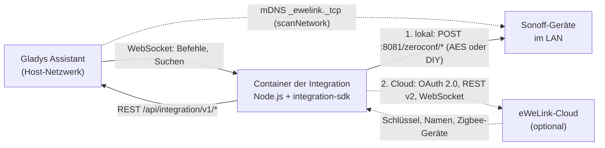
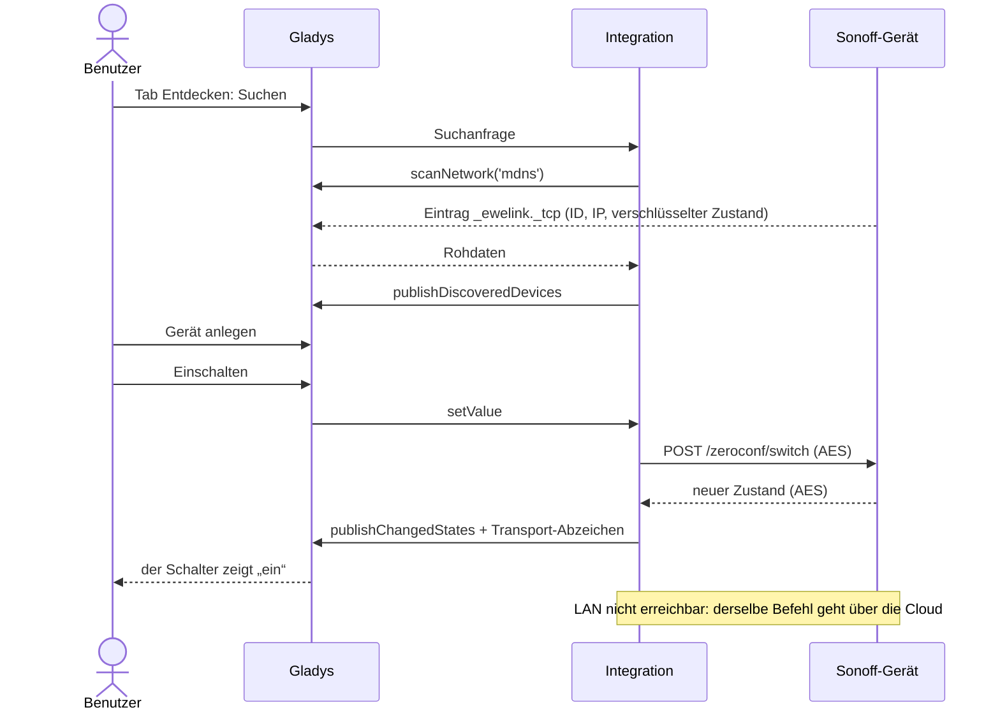
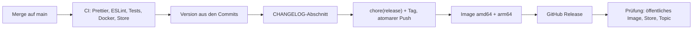

[English](README.md) · [Français](README.fr.md) · **Deutsch** · [Español](README.es.md)

# Sonoff / eWeLink für Gladys Assistant

[](LICENSE)
[](https://github.com/William-De71/gladys-sonoff-ewelink/releases)
[](https://github.com/William-De71/gladys-sonoff-ewelink/actions/workflows/release.yml)
[](https://gladysassistant.com)


Steuern Sie Ihre Sonoff- und eWeLink-Geräte mit Gladys über Ihr lokales
Netzwerk, mit der eWeLink-Cloud als optionaler Reserve. Die Geräte
funktionieren ohne Internet, und die Cloud ergänzt, was fehlt: Schlüssel,
Zigbee-Geräte, Fernsteuerung.

> Keine Verbindung zu ITEAD (Sonoff) oder CoolKit (eWeLink). Das lokale
> Protokoll und der Gerätekatalog stammen aus [SonoffLAN](https://github.com/AlexxIT/SonoffLAN)
> von AlexxIT (MIT).

## Funktionen

- **Zuerst lokal**: von Gladys weitergeleitete mDNS-Suche, verschlüsseltes
  (AES-128) lokales Protokoll und DIY-Modus, Zustandsabfrage, Befehle per
  Unicast.
- **Optionale Cloud** mit Ihrer eigenen eWeLink-Entwickler-App-ID: OAuth 2.0
  (oder E-Mail und Passwort), Gerätenamen und Schlüssel, Echtzeit-WebSocket,
  automatische Reserve, Zigbee-Geräte.
- **Transport-Abzeichen** pro Gerät (lokal / Cloud / nicht erreichbar), orange
  bei Einschränkung, und der Standardschalter „Lokale Verbindung bevorzugen“.
- **Über 110 Modelle**: Schalter, messende Steckdosen, Leuchten, Ventilatoren,
  Rollläden, Thermostate, Sensoren, Sirene, Wasserventile, RF Bridge.
- **4 Szenen-Auslöser, 3 Szenen-Aktionen, 3 Dashboard-Widgets**.
- Oberfläche, Dokumentation und README auf **Englisch, Französisch, Deutsch
  und Spanisch**.

## Architektur




Der Container liegt in einem Bridge-Netzwerk und sieht nie Multicast: Der Kern
von Gladys durchsucht mDNS für ihn und leitet die Rohdaten weiter. Befehle und
Zustandsabfragen laufen per Unicast, das die Bridge passiert.

## Von der Suche zum Zustand




## Unterstützte Geräte

| Familie     | Beispiele                                                       | Gladys-Funktionen                                            |
| ----------- | --------------------------------------------------------------- | ------------------------------------------------------------ |
| Schalter    | Basic, Mini, Micro, T1 1-3 Kanäle, 4CH, M5, TX Ultimate, ZBMINI | Schalter, Einschaltzustand, Impuls, LED-Anzeige              |
| Messung     | POW, POWR2, POWR3, S40, S60, DualR3, SPM-4Relay, MINI-1GSP      | Leistung, Spannung, Strom, Energie Tag / Monat / Zählerstand |
| Licht       | D1, MINI-DIM, B02, B05, L1, L2, L3, B1, Zigbee-Lampen           | Ein/Aus, Helligkeit, Farbe, Farbtemperatur                   |
| Ventilation | iFan02/03/04, Ventilatoren UIID 17, Aromadiffusor               | Lüftermodus, Oszillation, Windmodus, Licht                   |
| Rollläden   | King Q4, DualR3 im Motormodus, ZBCurtain, Garagentor, Tor       | öffnen / schließen / stoppen, Position                       |
| Klima       | TH10/16, THR316/320, TRVZB, NSPanel, Thermostat UIID 127        | Temperatur, Feuchte, Modus, Sollwert, Voreinstellung         |
| Sensoren    | DW2, SNZB-01/02/03/04/05/06, SAWF-Luftmonitore                  | Tür, Bewegung, Anwesenheit, Leck, CO2, PM, Druck, Batterie   |
| Weitere     | Sirene SNZB-09P, Ventile SWV, RF Bridge 433, NSPanel Pro        | Sirene, Ventil, Wasserverbrauch, RF-Codes, Tasten            |

Ein unbekanntes Modell mit einem Parameter `switch` oder `switches` erhält ein
Relais oder Kanäle, wie in SonoffLAN. Kameras werden nicht unterstützt
(proprietäres P2P-Video).

## Widgets, Szenen-Auslöser und Szenen-Aktionen


<!-- Echter Screenshot nötig: docs/screenshots/widgets.png, 1200x560, Dashboard mit den drei Widgets. -->

| Art           | Name                              | Anwendungsfall                                                       |
| ------------- | --------------------------------- | -------------------------------------------------------------------- |
| Widget        | Sonoff-Netzwerk                   | Wie jedes Gerät erreicht wird, Cloud-Sitzung, Kontingent, neu suchen |
| Widget        | Sonoff-Energie                    | Leistung, Spannung, Strom, Verbrauch und 24-h-Kurve                  |
| Widget        | RF-Fernbedienung                  | Bis zu vier RF-Codes als Tasten, zuletzt empfangene Codes            |
| Auslöser      | Sonoff-Taste gedrückt             | Funktasten, Fernbedienungen, Wandschalter (einfach bis dreifach)     |
| Auslöser      | RF-Code empfangen                 | RF-Fernbedienungen, Tür- und Bewegungsmelder                         |
| Auslöser      | Sonoff-Gerät online/offline       | Warnung, wenn ein Gerät nicht mehr erreichbar ist                    |
| Auslöser      | Status der eWeLink-Cloud geändert | Warnung bei verlorener Cloud, nötiger Anmeldung oder Kontingent      |
| Szenen-Aktion | RF-Code senden                    | Tor öffnen, angelernte Rollos einer RF Bridge senken                 |
| Szenen-Aktion | eWeLink-Befehl senden             | Rohe Parameter für das, was Gladys nicht steuert                     |
| Szenen-Aktion | Sonoff-Geräte neu suchen          | Liste nach einer Netzwerkänderung aktualisieren                      |

Szenen-Beispiele:

- Wenn die **Nachttisch-Taste** doppelt gedrückt wird, alle Lichter im Haus
  ausschalten.
- Wenn die RF Bridge nachts den Code der **Haustür** empfängt, den Flur
  einschalten und eine Nachricht senden.
- Wenn die **Gefriertruhen-Steckdose** nicht mehr erreichbar ist, eine
  Benachrichtigung mit `{{triggerEvent.data.device_name}}` senden.

## Voraussetzungen

- **Gladys Assistant 5.2.0 oder neuer**: Das Manifest nutzt Widgets,
  Szenen-Auslöser und -Aktionen (5.1.0) und ein geheimes Feld in einem
  Aktionsformular (5.2.0). Ältere Instanzen können die Integration nicht
  installieren.
- Geräte mit der originalen eWeLink-Firmware (oder im DIY-Modus) im selben
  Netzwerk wie Gladys, mDNS erlaubt.
- Geräte außerhalb des DIY-Modus brauchen ihren Schlüssel: aus der Cloud
  (einmal verbunden) oder manuell eingegeben.
- Für die Cloud: eine kostenlose Anwendung im
  [eWeLink-Entwicklerzentrum](https://dev.ewelink.cc) (50.000 API-Aufrufe pro
  Monat und Region).

## Installation

- **Aus dem Store (ein Klick)**: Gladys → Integrationen → „Sonoff“ suchen →
  Installieren.
- **Über die Repository-URL**: Gladys → Integrationen → Integration
  installieren → `https://github.com/William-De71/gladys-sonoff-ewelink`.
- **Entwicklermodus**: Gladys → Integrationen → Integration installieren →
  Entwicklermodus, mit dem Manifest eines Builds (die Zusammenfassung jedes
  Builds zeigt es an, inklusive `docker_image`).

## Konfiguration

<!-- Echter Screenshot nötig: docs/screenshots/configuration.png, 1280x900, der Tab Konfiguration mit dem Cloud-Abschnitt. -->

| Feld                                  | Standard | Beschreibung                                                   |
| ------------------------------------- | -------- | -------------------------------------------------------------- |
| Steuerung über das lokale Netzwerk    | an       | mDNS-Suche und lokale Befehle                                  |
| Intervall der Netzwerksuche (s)       | 60       | Wie oft das Netzwerk durchsucht wird (20 bis 3600)             |
| Lokales Aktualisierungsintervall (s)  | 30       | Wie oft jedes Gerät abgefragt wird (10 bis 600)                |
| Cloud-Verbindung                      | Keine    | Keine, Entwickleranwendung (OAuth), E-Mail und Passwort        |
| App ID / App Secret                   |          | Ihrer eWeLink-Entwickleranwendung                              |
| Region des Kontos                     | Europa   | Europa, Amerika, Asien, Festlandchina (andere werden versucht) |
| eWeLink-Konto                         |          | Schaltfläche Verbinden (OAuth-Modus)                           |
| E-Mail oder Telefon, Passwort         |          | Nur Passwort-Modus                                             |
| Ländervorwahl                         | +33      | Nur Passwort-Modus                                             |
| Tagesverbrauch der ersten POW-Modelle | an       | Stündliche Cloud-Abfrage für POW, POWR2 und S40                |
| Lokale Verbindung bevorzugen          | an       | Standardschalter von Gladys (beide Transporte deklariert)      |

Konfigurationsaktionen: **Gerät manuell hinzufügen** (ID, IP, Schlüssel),
**Manuelles Gerät entfernen**, **Verbindung testen**.

## Verwendung

1. Konfigurieren, dann den Tab **Entdecken** öffnen und eine Suche starten.
2. Die gewünschten Geräte anlegen; sie erscheinen mit ihrem
   Transport-Abzeichen.
3. Szenen mit den obigen Auslösern und Aktionen bauen und die Widgets einem
   Dashboard hinzufügen.

<!-- Echter Screenshot nötig: docs/screenshots/discover.png, 1280x800, der Tab Entdecken mit Sonoff-Geräten und ihren Abzeichen. -->

## Lokale Entwicklung

```bash
npm install
npm test               # node --test, gegen das Fake-Gladys des SDK
npm run lint           # ESLint
npm run format:check   # Prettier
npm run format         # Prettier, direkt korrigieren
npx github:GladysAssistant/integration-store . --skip-image-check
./scripts/build-cover.sh   # cover.svg -> cover.jpg (800x534, < 150 KB)
```

Der Supervisor von Gladys setzt `GLADYS_HOST_API_URL`,
`GLADYS_INTEGRATION_TOKEN` und `GLADYS_INTEGRATION_SELECTOR`. Optional:
`LOG_LEVEL` (`debug`, `info`, `warn`, `error`) und `DATA_DIR` (standardmäßig
`/data`). Der Code liegt in `src/`: `ewelink/` (lokales und Cloud-Protokoll),
`devices/` (UIID-Katalog und Umrechnungen), `manager.js` (Routing, Abfrage,
Transporte), `widgets.js`, `scenes.js`, `actions.js`.

## Tests

`npm test` führt rund hundert Tests aus, die nie das Netzwerk berühren: das
Protokoll (Verschlüsselung, mDNS-Einträge, Wiederholungen, Signaturen gegen
die Beispiele der eWeLink-Dokumentation), jedes UIID des Katalogs gegen das
Fake-Gladys, End-to-End-Szenarien (nur lokal, OAuth, Cloud-Reserve,
eingeschränkte Abzeichen, Szenen-Ereignisse), die Widget-Inhalte
(`validateWidgetContent`), die deklarierten Ausgaben der Szenen-Aktionen, die
vier Sprachen und das Release-Skript.

## Release-Prozess




Jeder Merge auf `main` veröffentlicht automatisch, wenn die Commits es
rechtfertigen:

| Commit (PR-Titel)                                               | Version unter 1.0.0 | Ab 1.0.0 |
| --------------------------------------------------------------- | ------------------- | -------- |
| `feat: ...`                                                     | Minor               | Minor    |
| `fix: ...`, `perf: ...`                                         | Patch               | Patch    |
| `feat!: ...` oder `BREAKING CHANGE:`                            | Minor               | Major    |
| nur `docs`, `chore`, `ci`, `test`, `style`, `refactor`, `build` | keine               | keine    |

- Pull Requests werden per **Squash** zusammengeführt: Der PR-Titel wird zum
  Commit, zum Versionssprung und zur Changelog-Zeile. `pr-title.yml` prüft ihn
  (Conventional Commits, Englisch, mindestens 10 Zeichen). `CHANGELOG.md` wird
  generiert: nie von Hand bearbeiten.
- **1.0.0** entscheidet der Maintainer: Actions → Release → Run workflow,
  `release-as: 1.0.0`. Die Eingabe `dry-run` zeigt Version und Changelog in der
  Job-Zusammenfassung, ohne etwas zu veröffentlichen.
- **Geschützter main-Zweig**: Der Release-Commit wird von GitHub Actions
  gepusht. Fügen Sie „GitHub Actions“ der Ausnahmeliste der Regel hinzu
  (Settings → Rules) oder nutzen Sie das Token einer GitHub App; sonst wird der
  Push abgelehnt und nichts veröffentlicht.

## Fehlerbehebung

- Kein Gerät gefunden: dasselbe Netzwerk wie Gladys, mDNS erlaubt; **Verbindung
  testen** ausführen.
- Oranges Abzeichen „Schlüssel unbekannt“: Cloud einmal verbinden oder den
  Schlüssel manuell hinzufügen.
- „Anderswo angemeldet“: Ihre eigene Entwickleranwendung verwenden.
- Kontingent erschöpft: Das LAN funktioniert bis zum 1. des Monats weiter.
- Eingefrorene Leistung: Seit 2026 leitet eWeLink die Leistung nicht mehr über
  die Cloud weiter.
- Protokolle: der Tab **Protokolle** der Integration.

## Mitwirken

Issues und Pull Requests sind willkommen. Vor dem Push `npm run format:check`,
`npm run lint` und `npm test` ausführen, den PR-Titel wie die Changelog-Zeile
schreiben und die vier Sprachen synchron halten (`test/i18n.test.js` prüft
sie). Neues Modell: das UIID mit einem Test in `src/devices/specs.js`
ergänzen.

## Sicherheit

Schwachstellen bitte privat melden, siehe [SECURITY.md](SECURITY.md). Tokens,
Passwörter und Geräteschlüssel werden nie protokolliert; die Cloud-Sitzung wird
in der Konfiguration von Gladys gespeichert, die Geräteliste in `/data`.

## Lizenz

[Apache-Lizenz 2.0](LICENSE), siehe auch [NOTICE](NOTICE). Das lokale
Protokoll und der Gerätekatalog stammen aus SonoffLAN (MIT, © AlexxIT).
