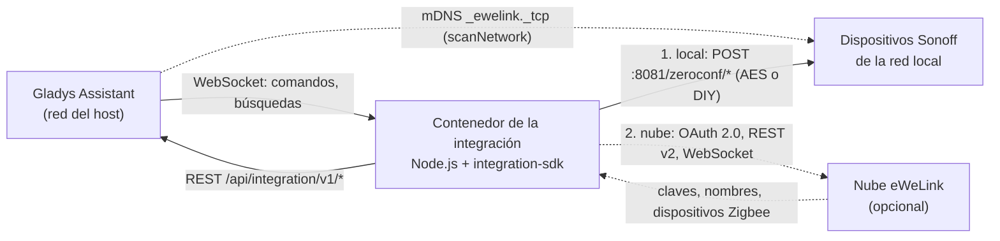
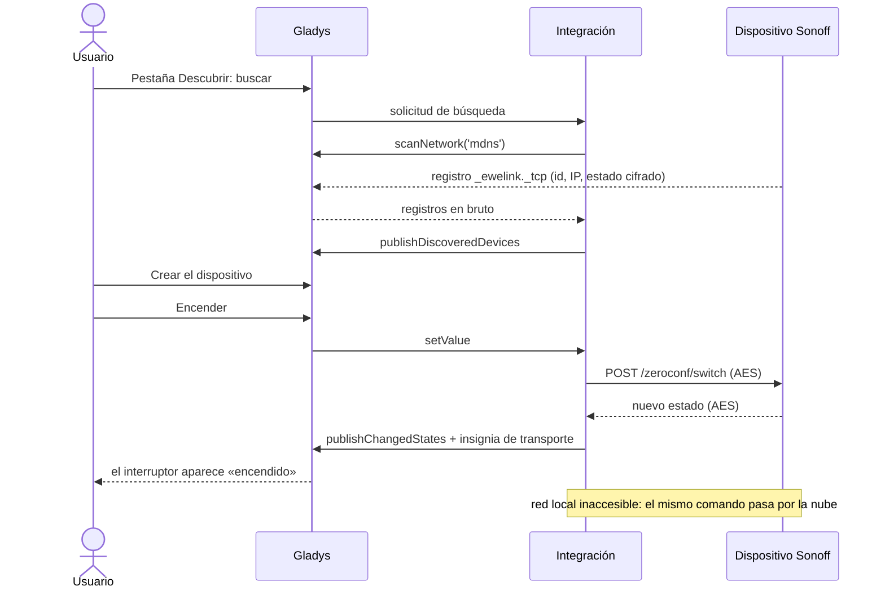
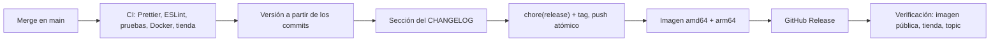

[English](README.md) · [Français](README.fr.md) · [Deutsch](README.de.md) · **Español**

# Sonoff / eWeLink para Gladys Assistant

[](LICENSE)
[](https://github.com/William-De71/gladys-sonoff-ewelink/releases)
[](https://github.com/William-De71/gladys-sonoff-ewelink/actions/workflows/release.yml)
[](https://gladysassistant.com)


Controle sus dispositivos Sonoff y eWeLink desde Gladys a través de su red
local, con la nube de eWeLink como respaldo opcional. Los dispositivos
funcionan sin internet, y la nube completa lo que falta: claves de cifrado,
dispositivos Zigbee, control remoto.

> Sin afiliación con ITEAD (Sonoff) ni con CoolKit (eWeLink). El protocolo
> local y el catálogo de dispositivos proceden de [SonoffLAN](https://github.com/AlexxIT/SonoffLAN)
> de AlexxIT (MIT).

## Funciones

- **Primero en local**: descubrimiento mDNS retransmitido por Gladys,
  protocolo local cifrado (AES-128) y modo DIY, consulta del estado, comandos
  en unicast.
- **Nube opcional** con su propio App ID de desarrollador eWeLink: OAuth 2.0 (o
  correo y contraseña), nombres y claves de los dispositivos, WebSocket en
  tiempo real, respaldo automático, dispositivos Zigbee.
- **Insignia de transporte** por dispositivo (local / nube / inaccesible),
  naranja en modo degradado, y el interruptor estándar «Preferir la conexión
  local».
- **Más de 110 modelos**: interruptores, enchufes con medición, iluminación,
  ventiladores, persianas, termostatos, sensores, sirena, válvulas de agua, RF
  Bridge.
- **4 disparadores de escena, 3 acciones de escena, 3 widgets**.
- Interfaz, documentación y README en **inglés, francés, alemán y español**.

## Arquitectura




El contenedor está en una red bridge y nunca ve el multicast: el núcleo de
Gladys recorre el mDNS por él y le retransmite los registros en bruto. Los
comandos y las consultas de estado van en unicast, que atraviesa el bridge.

## De la búsqueda al estado




## Dispositivos compatibles

| Familia       | Ejemplos                                                         | Funciones de Gladys                                      |
| ------------- | ---------------------------------------------------------------- | -------------------------------------------------------- |
| Interruptores | Basic, Mini, Micro, T1 1-3 canales, 4CH, M5, TX Ultimate, ZBMINI | interruptor, estado al encender, impulso, LED            |
| Medición      | POW, POWR2, POWR3, S40, S60, DualR3, SPM-4Relay, MINI-1GSP       | potencia, tensión, corriente, energía día / mes / índice |
| Iluminación   | D1, MINI-DIM, B02, B05, L1, L2, L3, B1, bombillas Zigbee         | encendido, brillo, color, temperatura de color           |
| Ventilación   | iFan02/03/04, ventiladores UIID 17, difusor de aceites           | modo del ventilador, oscilación, modo de viento, luz     |
| Persianas     | King Q4, DualR3 en modo motor, ZBCurtain, garaje, portón         | abrir / cerrar / parar, posición                         |
| Clima         | TH10/16, THR316/320, TRVZB, NSPanel, termostato UIID 127         | temperatura, humedad, modo, consigna, preajuste          |
| Sensores      | DW2, SNZB-01/02/03/04/05/06, monitores de aire SAWF              | apertura, movimiento, presencia, fuga, CO2, PM, presión  |
| Otros         | sirena SNZB-09P, válvulas SWV, RF Bridge 433, NSPanel Pro        | sirena, válvula, agua consumida, códigos RF, botones     |

Un modelo desconocido que envía un parámetro `switch` o `switches` recibe un
relé o canales, como en SonoffLAN. Las cámaras no son compatibles (vídeo P2P
propietario).

## Widgets, disparadores y acciones de escena


<!-- Captura real necesaria: docs/screenshots/widgets.png, 1200x560, panel con los tres widgets. -->

| Tipo             | Nombre                                    | Caso de uso                                                      |
| ---------------- | ----------------------------------------- | ---------------------------------------------------------------- |
| Widget           | Red Sonoff                                | Cómo se accede a cada dispositivo, sesión en la nube, cuota      |
| Widget           | Energía Sonoff                            | Potencia, tensión, corriente, consumo y curva de 24 h            |
| Widget           | Mando RF                                  | Hasta cuatro códigos RF como botones, últimos códigos recibidos  |
| Disparador       | Botón Sonoff pulsado                      | Botones inalámbricos, mandos, interruptores (simple a triple)    |
| Disparador       | Código RF recibido                        | Mandos RF, sensores de apertura y de movimiento                  |
| Disparador       | Dispositivo Sonoff conectado/desconectado | Alerta cuando un dispositivo deja de ser accesible               |
| Disparador       | Estado de la nube eWeLink cambiado        | Alerta cuando la nube se pierde, pide sesión o agota su cuota    |
| Acción de escena | Enviar un código RF                       | Abrir el portón, bajar las persianas aprendidas por un RF Bridge |
| Acción de escena | Enviar un comando eWeLink                 | Parámetros en bruto para lo que Gladys no controla               |
| Acción de escena | Volver a buscar dispositivos Sonoff       | Actualizar la lista tras un cambio en la red                     |

Ejemplos de escenas:

- Cuando el **botón de la mesilla** recibe una doble pulsación, apagar todas
  las luces de la casa.
- Cuando el RF Bridge recibe el código de la **puerta de entrada** por la
  noche, encender el recibidor y enviar un mensaje.
- Cuando el **enchufe del congelador** deja de ser accesible, enviar una
  notificación con `{{triggerEvent.data.device_name}}`.

## Requisitos previos

- **Gladys Assistant 5.3.0 o posterior**: el manifiesto usa widgets,
  disparadores y acciones de escena (5.1.0), un campo secreto en un formulario
  de acción (5.2.0) y las palabras clave del catálogo de Gladys 5.3. Las instancias anteriores no pueden instalar la
  integración.
- Dispositivos con el firmware eWeLink original (o en modo DIY) en la misma
  red que Gladys, mDNS permitido.
- Los dispositivos fuera del modo DIY necesitan su clave de cifrado: desde la
  nube (conectada una vez) o introducida a mano.
- Para la nube: una aplicación gratuita en el
  [centro de desarrolladores de eWeLink](https://dev.ewelink.cc) (50.000
  llamadas a la API al mes y por región).

## Instalación

- **Desde la tienda (un clic)**: Gladys → Integraciones → buscar «Sonoff» →
  Instalar.
- **Desde la URL del repositorio**: Gladys → Integraciones → Instalar una
  integración → `https://github.com/William-De71/gladys-sonoff-ewelink`.
- **Modo desarrollador**: Gladys → Integraciones → Instalar una integración →
  Modo desarrollador, con el manifiesto de una compilación (el resumen de cada
  compilación lo muestra, `docker_image` incluido).

## Configuración

<!-- Captura real necesaria: docs/screenshots/configuration.png, 1280x900, la pestaña Configuración con la sección de la nube. -->

| Campo                                | Por defecto | Descripción                                                       |
| ------------------------------------ | ----------- | ----------------------------------------------------------------- |
| Control por la red local             | activado    | Descubrimiento mDNS y comandos locales                            |
| Intervalo de búsqueda en la red (s)  | 60          | Frecuencia de búsqueda en la red (20 a 3600)                      |
| Intervalo de actualización local (s) | 30          | Frecuencia de consulta de cada dispositivo (10 a 600)             |
| Conexión a la nube                   | Ninguna     | Ninguna, Aplicación de desarrollador (OAuth), Correo y contraseña |
| App ID / App Secret                  |             | De su aplicación de desarrollador eWeLink                         |
| Región de la cuenta                  | Europa      | Europa, América, Asia, China continental (se prueban las demás)   |
| Cuenta eWeLink                       |             | Botón Conectar (modo OAuth)                                       |
| Correo o teléfono, contraseña        |             | Solo modo contraseña                                              |
| Prefijo telefónico del país          | +33         | Solo modo contraseña                                              |
| Consumo diario de los primeros POW   | activado    | Consulta horaria a la nube para POW, POWR2 y S40                  |
| Preferir la conexión local           | activado    | Interruptor estándar de Gladys (dos transportes declarados)       |

Acciones de configuración: **Añadir un dispositivo a mano** (ID, IP, clave),
**Quitar un dispositivo manual**, **Probar la conexión**.

## Uso

1. Configure, luego abra la pestaña **Descubrir** e inicie una búsqueda.
2. Cree los dispositivos que quiera; aparecen con su insignia de transporte.
3. Construya escenas con los disparadores y acciones anteriores, y añada los
   widgets a un panel.

<!-- Captura real necesaria: docs/screenshots/discover.png, 1280x800, la pestaña Descubrir con dispositivos Sonoff y sus insignias. -->

## Desarrollo local

```bash
npm install
npm test               # node --test, contra el Gladys simulado del SDK
npm run lint           # ESLint
npm run format:check   # Prettier
npm run format         # Prettier, corrige en el sitio
npx github:GladysAssistant/integration-store . --skip-image-check
./scripts/build-cover.sh   # cover.svg -> cover.jpg (800x534, < 150 KB)
```

El supervisor de Gladys inyecta `GLADYS_HOST_API_URL`,
`GLADYS_INTEGRATION_TOKEN` y `GLADYS_INTEGRATION_SELECTOR`. Opcional:
`LOG_LEVEL` (`debug`, `info`, `warn`, `error`) y `DATA_DIR` (`/data` por
defecto). El código está en `src/`: `ewelink/` (protocolos local y en la
nube), `devices/` (catálogo UIID y conversiones), `manager.js` (enrutamiento,
consulta, transportes), `widgets.js`, `scenes.js`, `actions.js`.

## Pruebas

`npm test` ejecuta un centenar de pruebas que nunca tocan la red: el protocolo
(cifrado, registros mDNS, reintentos, firmas contra los ejemplos de la
documentación de eWeLink), cada UIID del catálogo contra el Gladys simulado,
escenarios de extremo a extremo (solo local, OAuth, respaldo en la nube,
insignias degradadas, eventos de escena), el contenido de los widgets
(`validateWidgetContent`), las salidas declaradas de las acciones de escena,
los cuatro idiomas y el script de publicación.

## Proceso de publicación




Cada merge en `main` publica una versión cuando los commits lo justifican:

| Commit (título de la PR)                                         | Versión antes de 1.0.0 | Desde 1.0.0 |
| ---------------------------------------------------------------- | ---------------------- | ----------- |
| `feat: ...`                                                      | menor                  | menor       |
| `fix: ...`, `perf: ...`                                          | parche                 | parche      |
| `feat!: ...` o `BREAKING CHANGE:`                                | menor                  | mayor       |
| solo `docs`, `chore`, `ci`, `test`, `style`, `refactor`, `build` | ninguna                | ninguna     |

- Las pull requests se fusionan con **squash**: el título de la PR se
  convierte en el commit, el salto de versión y la línea del changelog.
  `pr-title.yml` lo comprueba (Conventional Commits, en inglés, 10 caracteres
  como mínimo). `CHANGELOG.md` se genera: no lo edite nunca a mano.
- **1.0.0** lo decide el mantenedor: Actions → Release → Run workflow,
  `release-as: 1.0.0`. La entrada `dry-run` muestra la versión y el changelog
  en el resumen del job sin publicar nada.
- **Rama main protegida**: el commit de publicación lo envía GitHub Actions.
  Añada «GitHub Actions» a la lista de excepciones de la regla (Settings →
  Rules) o use el token de una GitHub App; si no, el push se rechaza y no se
  publica nada.

## Solución de problemas

- No se encuentra ningún dispositivo: misma red que Gladys, mDNS permitido;
  ejecute **Probar la conexión**.
- Insignia naranja «clave desconocida»: conecte la nube una vez o añada la
  clave a mano.
- «Sesión iniciada en otro lugar»: use su propia aplicación de desarrollador.
- Cuota agotada: la red local funciona hasta el día 1 del mes.
- Potencia congelada: desde 2026 eWeLink ya no transmite la potencia por la
  nube.
- Registros: la pestaña **Registros** de la integración.

## Contribuir

Issues y pull requests son bienvenidas. Ejecute `npm run format:check`,
`npm run lint` y `npm test` antes de hacer push, escriba el título de la PR
como la línea del changelog y mantenga los cuatro idiomas sincronizados
(`test/i18n.test.js` los comprueba). Modelo nuevo: añada el UIID en
`src/devices/specs.js` con una prueba.

## Seguridad

Informe de las vulnerabilidades en privado, consulte [SECURITY.md](SECURITY.md).
Los tokens, contraseñas y claves de dispositivo nunca se registran; la sesión
en la nube se guarda en la configuración de Gladys, la lista de dispositivos en
`/data`.

## Licencia

[Licencia Apache 2.0](LICENSE), consulte también [NOTICE](NOTICE). El
protocolo local y el catálogo de dispositivos proceden de SonoffLAN (MIT,
© AlexxIT).
