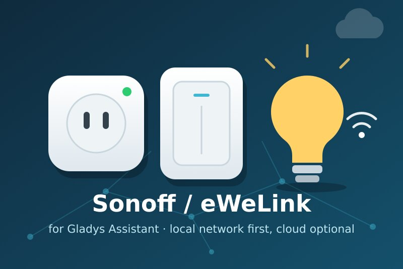
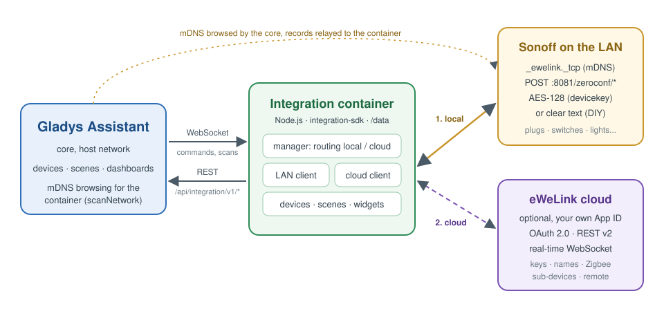
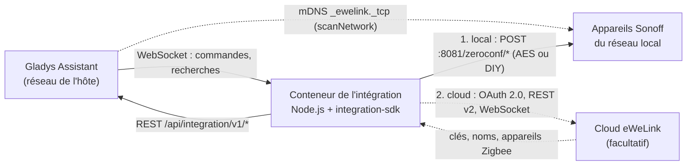
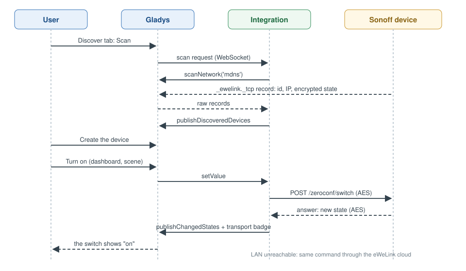
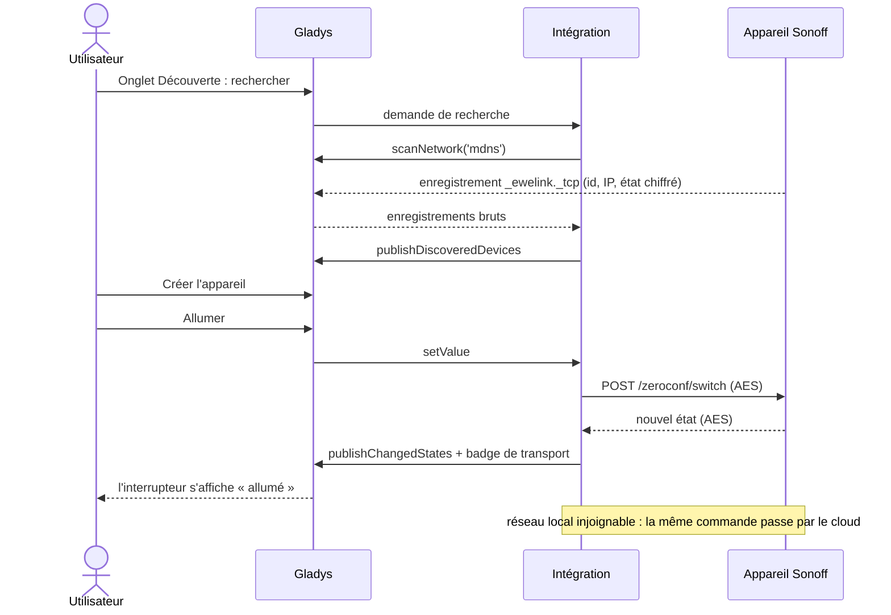
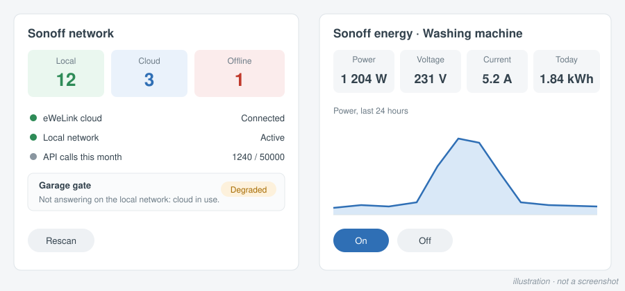
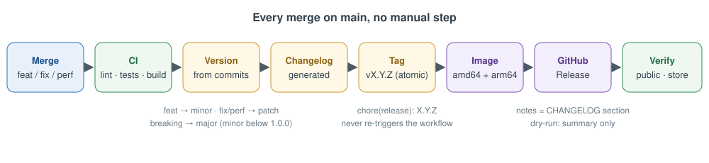
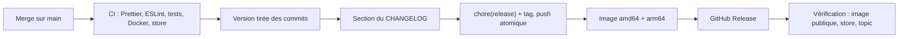

[English](README.md) · **Français** · [Deutsch](README.de.md) · [Español](README.es.md)

# Sonoff / eWeLink pour Gladys Assistant

[](LICENSE)
[](https://github.com/William-De71/gladys-sonoff-ewelink/releases)
[](https://github.com/William-De71/gladys-sonoff-ewelink/actions/workflows/release.yml)
[](https://gladysassistant.com)



Pilotez vos appareils Sonoff et eWeLink depuis Gladys par votre réseau local,
avec le cloud eWeLink en secours facultatif. Les appareils fonctionnent sans
internet, et le cloud complète ce qui manque : clés de chiffrement, appareils
Zigbee, contrôle à distance.

> Non affilié à ITEAD (Sonoff) ni à CoolKit (eWeLink). Le protocole local et
> le catalogue d'appareils sont repris de [SonoffLAN](https://github.com/AlexxIT/SonoffLAN)
> d'AlexxIT (MIT).

## Fonctionnalités

- **Le local d'abord** : découverte mDNS relayée par Gladys, protocole local
  chiffré (AES-128) et mode DIY, interrogation de l'état, commandes en unicast.
- **Cloud facultatif** avec votre propre App ID développeur eWeLink : OAuth
  2.0 (ou e-mail et mot de passe), noms et clés de chiffrement des appareils,
  WebSocket en temps réel, repli automatique, appareils Zigbee.
- **Badge de transport** par appareil (local / cloud / injoignable), orange en
  mode dégradé, et l'interrupteur standard « Privilégier la connexion locale ».
- **Plus de 110 modèles** : interrupteurs, prises avec mesure, éclairages,
  ventilateurs, volets, thermostats, capteurs, sirène, vannes d'eau, RF Bridge.
- **4 déclencheurs de scène, 3 actions de scène, 3 widgets**.
- Interface, documentation et README en **anglais, français, allemand et
  espagnol**.

## Architecture





Le conteneur est sur un réseau bridge et ne voit jamais le multicast : le cœur
de Gladys parcourt le mDNS pour lui et relaie les enregistrements bruts. Les
commandes et les demandes d'état passent en unicast, qui traverse le bridge.

## De la recherche à l'état





## Appareils pris en charge

| Famille       | Exemples                                                       | Fonctionnalités Gladys                                     |
| ------------- | -------------------------------------------------------------- | ---------------------------------------------------------- |
| Interrupteurs | Basic, Mini, Micro, T1 1-3 voies, 4CH, M5, TX Ultimate, ZBMINI | interrupteur, état à la mise sous tension, impulsion, LED  |
| Mesure        | POW, POWR2, POWR3, S40, S60, DualR3, SPM-4Relay, MINI-1GSP     | puissance, tension, intensité, énergie jour / mois / index |
| Éclairage     | D1, MINI-DIM, B02, B05, L1, L2, L3, B1, ampoules Zigbee        | marche/arrêt, luminosité, couleur, température de couleur  |
| Ventilation   | iFan02/03/04, ventilateurs UIID 17, diffuseur d'huiles         | mode du ventilateur, oscillation, mode de vent, lumière    |
| Volets        | King Q4, DualR3 en mode moteur, ZBCurtain, garage, portail     | ouvrir / fermer / arrêter, position                        |
| Climat        | TH10/16, THR316/320, TRVZB, NSPanel, thermostat UIID 127       | température, humidité, mode, consigne, préréglage          |
| Capteurs      | DW2, SNZB-01/02/03/04/05/06, moniteurs d'air SAWF              | ouverture, mouvement, présence, fuite, CO2, PM, pression   |
| Autres        | sirène SNZB-09P, vannes SWV, RF Bridge 433, NSPanel Pro        | sirène, vanne, eau consommée, codes RF, boutons            |

Un modèle inconnu qui remonte un paramètre `switch` ou `switches` reçoit un
relais ou des voies, comme dans SonoffLAN. Les caméras ne sont pas prises en
charge (vidéo P2P propriétaire).

## Widgets, déclencheurs et actions de scène



<!-- Vraie capture à fournir : docs/screenshots/widgets.png, 1200x560, tableau de bord avec les trois widgets. -->

| Type            | Nom                           | Cas d'usage                                                        |
| --------------- | ----------------------------- | ------------------------------------------------------------------ |
| Widget          | Réseau Sonoff                 | Comment chaque appareil est joint, session cloud, quota, recherche |
| Widget          | Énergie Sonoff                | Puissance, tension, intensité, consommation et courbe 24 h         |
| Widget          | Télécommande RF               | Jusqu'à quatre codes RF en boutons, derniers codes reçus           |
| Déclencheur     | Bouton Sonoff appuyé          | Boutons sans fil, télécommandes, interrupteurs (simple à triple)   |
| Déclencheur     | Code RF reçu                  | Télécommandes, détecteurs d'ouverture et de mouvement RF           |
| Déclencheur     | Appareil Sonoff (dé)connecté  | Alerte quand un appareil n'est plus joignable                      |
| Déclencheur     | État du cloud eWeLink modifié | Alerte quand le cloud est perdu, à reconnecter ou sans quota       |
| Action de scène | Envoyer un code RF            | Ouvrir le portail, baisser les stores appris par un RF Bridge      |
| Action de scène | Envoyer une commande eWeLink  | Paramètres bruts pour ce que Gladys ne pilote pas                  |
| Action de scène | Relancer la recherche Sonoff  | Rafraîchir la liste après un changement de réseau                  |

Exemples de scènes :

- Quand le **bouton de chevet** reçoit un double appui, éteindre toutes les
  lumières de la maison.
- Quand le RF Bridge reçoit le code de la **porte d'entrée** la nuit, allumer
  l'entrée et envoyer un message.
- Quand la **prise du congélateur** devient injoignable, envoyer une
  notification avec `{{triggerEvent.data.device_name}}`.

## Prérequis

- **Gladys Assistant 5.3.0 ou ultérieur** : le manifeste utilise les widgets,
  déclencheurs et actions de scène (5.1.0), un champ secret dans un
  formulaire d'action (5.2.0) et les mots-clés du catalogue de Gladys 5.3. Les instances plus anciennes ne peuvent pas
  installer l'intégration.
- Des appareils sous le firmware eWeLink d'origine (ou en mode DIY) sur le
  même réseau que Gladys, mDNS autorisé.
- Les appareils hors mode DIY ont besoin de leur clé de chiffrement : par le
  cloud (connecté une fois) ou saisie à la main.
- Pour le cloud : une application gratuite sur le
  [centre développeur eWeLink](https://dev.ewelink.cc) (50 000 appels d'API
  par mois et par région).

## Installation

- **Depuis le store (un clic)** : Gladys → Intégrations → chercher « Sonoff »
  → Installer.
- **Depuis l'URL du dépôt** : Gladys → Intégrations → Installer une
  intégration → `https://github.com/William-De71/gladys-sonoff-ewelink`.
- **Mode développeur** : Gladys → Intégrations → Installer une intégration →
  Mode développeur, avec le manifeste d'une image (le résumé de chaque build
  l'affiche, `docker_image` compris).

## Configuration

<!-- Vraie capture à fournir : docs/screenshots/configuration.png, 1280x900, l'onglet Configuration avec la section cloud. -->

| Champ                                    | Défaut | Description                                                     |
| ---------------------------------------- | ------ | --------------------------------------------------------------- |
| Contrôle par le réseau local             | activé | Découverte mDNS et commandes locales                            |
| Intervalle de recherche réseau (s)       | 60     | Fréquence de recherche sur le réseau (20 à 3600)                |
| Intervalle de rafraîchissement local (s) | 30     | Fréquence d'interrogation de chaque appareil (10 à 600)         |
| Connexion au cloud                       | Aucune | Aucune, Application développeur (OAuth), E-mail et mot de passe |
| App ID / App Secret                      |        | De votre application développeur eWeLink                        |
| Région du compte                         | Europe | Europe, Amériques, Asie, Chine continentale (autres essayées)   |
| Compte eWeLink                           |        | Bouton Connecter (mode OAuth)                                   |
| E-mail ou téléphone, mot de passe        |        | Mode mot de passe uniquement                                    |
| Indicatif téléphonique du pays           | +33    | Mode mot de passe uniquement                                    |
| Consommation du jour des premiers POW    | activé | Requête cloud horaire pour POW, POWR2 et S40                    |
| Privilégier la connexion locale          | activé | Interrupteur standard de Gladys (deux transports déclarés)      |

Actions de configuration : **Ajouter un appareil à la main** (ID, IP, clé),
**Retirer un appareil manuel**, **Tester la connexion**.

## Utilisation

1. Configurez, puis ouvrez l'onglet **Découverte** et lancez une recherche.
2. Créez les appareils voulus ; ils apparaissent avec leur badge de transport.
3. Construisez des scènes avec les déclencheurs et actions ci-dessus, et
   ajoutez les widgets à un tableau de bord.

<!-- Vraie capture à fournir : docs/screenshots/discover.png, 1280x800, l'onglet Découverte avec des appareils Sonoff et leurs badges. -->

## Développement local

```bash
npm install
npm test               # node --test, contre le faux Gladys du SDK
npm run lint           # ESLint
npm run format:check   # Prettier
npm run format         # Prettier, correction sur place
npx github:GladysAssistant/integration-store . --skip-image-check
./scripts/build-cover.sh   # cover.svg -> cover.jpg (800x534, < 150 Ko)
```

Le superviseur de Gladys injecte `GLADYS_HOST_API_URL`,
`GLADYS_INTEGRATION_TOKEN` et `GLADYS_INTEGRATION_SELECTOR`. Facultatif :
`LOG_LEVEL` (`debug`, `info`, `warn`, `error`) et `DATA_DIR` (`/data` par
défaut). Le code est dans `src/` : `ewelink/` (protocoles local et cloud),
`devices/` (catalogue UIID et conversions), `manager.js` (routage,
interrogation, transports), `widgets.js`, `scenes.js`, `actions.js`.

## Tests

`npm test` lance une centaine de tests qui ne touchent jamais le réseau : le
protocole (chiffrement, enregistrements mDNS, nouvelles tentatives, signatures
contre les exemples de la doc eWeLink), chaque UIID du catalogue contre le faux
Gladys, des scénarios de bout en bout (local seul, OAuth, repli cloud, badges
dégradés, évènements de scène), le contenu des widgets
(`validateWidgetContent`), les sorties déclarées des actions de scène, les
quatre langues et le script de release.

## Processus de release





Chaque merge sur `main` publie une version quand les commits le justifient :

| Commit (titre de PR)                                              | Version avant 1.0.0 | À partir de 1.0.0 |
| ----------------------------------------------------------------- | ------------------- | ----------------- |
| `feat: ...`                                                       | mineure             | mineure           |
| `fix: ...`, `perf: ...`                                           | correctif           | correctif         |
| `feat!: ...` ou `BREAKING CHANGE:`                                | mineure             | majeure           |
| `docs`, `chore`, `ci`, `test`, `style`, `refactor`, `build` seuls | aucune              | aucune            |

- Les pull requests sont fusionnées en **squash** : le titre de PR devient le
  commit, le saut de version et la ligne du changelog. `pr-title.yml` le
  vérifie (Conventional Commits, en anglais, 10 caractères au moins).
  `CHANGELOG.md` est généré : ne jamais l'éditer.
- **1.0.0** se décide à la main : Actions → Release → Run workflow,
  `release-as: 1.0.0`. L'entrée `dry-run` affiche la version et le changelog
  dans le résumé du job sans rien publier.
- **Branche main protégée** : le commit de release est poussé par GitHub
  Actions. Ajoutez « GitHub Actions » à la liste de contournement de la règle
  (Settings → Rules), ou utilisez le jeton d'une GitHub App ; sinon le push est
  refusé et rien n'est publié.

## Dépannage

- Aucun appareil trouvé : même réseau que Gladys, mDNS autorisé ; lancez
  **Tester la connexion**.
- Badge orange « clé inconnue » : connectez le cloud une fois, ou ajoutez la
  clé à la main.
- « Connecté ailleurs » : utilisez votre propre application développeur.
- Quota épuisé : le réseau local fonctionne jusqu'au 1er du mois.
- Puissance figée : depuis 2026 eWeLink ne relaie plus la puissance par le
  cloud.
- Journaux : l'onglet **Journaux** de l'intégration.

## Contribuer

Issues et pull requests sont les bienvenues. Lancez `npm run format:check`,
`npm run lint` et `npm test` avant de pousser, écrivez le titre de PR comme la
ligne du changelog, et gardez les quatre langues synchronisées
(`test/i18n.test.js` les vérifie). Nouveau modèle : ajoutez l'UIID dans
`src/devices/specs.js` avec un test.

## Sécurité

Signalez une faille en privé, voir [SECURITY.md](SECURITY.md). Les jetons, mots
de passe et clés d'appareil ne sont jamais journalisés ; la session cloud est
stockée dans la configuration de Gladys, la liste des appareils dans `/data`.

## Licence

[Licence Apache 2.0](LICENSE), voir aussi [NOTICE](NOTICE). Le protocole local
et le catalogue d'appareils sont repris de SonoffLAN (MIT, © AlexxIT).
