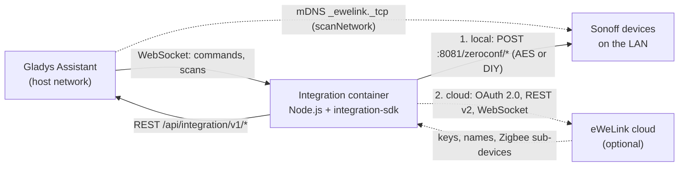
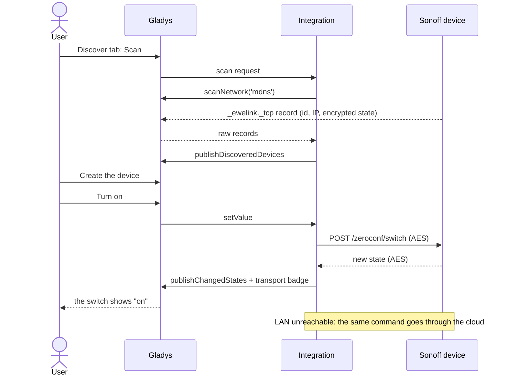
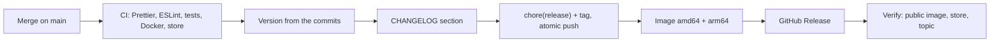

**English** · [Français](README.fr.md) · [Deutsch](README.de.md) · [Español](README.es.md)

# Sonoff / eWeLink for Gladys Assistant

[](LICENSE)
[](https://github.com/William-De71/gladys-sonoff-ewelink/releases)
[](https://github.com/William-De71/gladys-sonoff-ewelink/actions/workflows/release.yml)
[](https://gladysassistant.com)


Control your Sonoff and eWeLink devices from Gladys over your local network,
with the eWeLink cloud as an optional backup. Devices keep working without the
internet, and the cloud fills the gaps: encryption keys, Zigbee sub-devices,
remote control.

> Not affiliated with ITEAD (Sonoff) nor CoolKit (eWeLink). The LAN protocol
> and the device catalog are ported from [SonoffLAN](https://github.com/AlexxIT/SonoffLAN)
> by AlexxIT (MIT).

## Features

- **Local first**: mDNS discovery relayed by Gladys, encrypted (AES-128) and
  DIY-mode LAN protocol, state polling, commands in unicast.
- **Optional cloud** with your own eWeLink developer App ID: OAuth 2.0 (or
  e-mail and password), device names and encryption keys, real-time
  WebSocket, automatic fallback, Zigbee sub-devices.
- **Transport badge** per device (local / cloud / unreachable), orange when
  degraded, and the standard "Prefer the local connection" toggle.
- **Over 110 models**: switches, metering plugs, lights, fans, covers,
  thermostats, sensors, siren, water valves, RF Bridge.
- **4 scene triggers, 3 scene actions, 3 dashboard widgets**.
- Interface, docs and README in **English, French, German and Spanish**.

## Architecture




The container sits on a bridge network and never sees multicast: the Gladys
core browses mDNS for it and relays the raw records. Commands and state
requests travel in unicast, which crosses the bridge.

## From the scan to the state




## Supported devices

| Family   | Examples                                                     | Gladys features                                          |
| -------- | ------------------------------------------------------------ | -------------------------------------------------------- |
| Switches | Basic, Mini, Micro, T1 1-3CH, 4CH, M5, TX Ultimate, ZBMINI   | switch, power-on state, inching, LED indicator           |
| Metering | POW, POWR2, POWR3, S40, S60, DualR3, SPM-4Relay, MINI-1GSP   | power, voltage, current, energy today / month / index    |
| Lights   | D1, MINI-DIM, B02, B05, L1, L2, L3, B1, Zigbee bulbs         | on/off, brightness, color, color temperature             |
| Fans     | iFan02/03/04, UIID 17 fans, oil diffuser                     | fan mode, oscillation, wind mode, light                  |
| Covers   | King Q4, DualR3 motor mode, ZBCurtain, garage door, gate     | open / close / stop, position                            |
| Climate  | TH10/16, THR316/320, TRVZB, NSPanel, UIID 127 thermostat     | temperature, humidity, mode, setpoint, preset            |
| Sensors  | DW2, SNZB-01/02/03/04/05/06, SAWF air monitors               | door, motion, presence, leak, CO2, PM, pressure, battery |
| Others   | SNZB-09P siren, SWV water valves, RF Bridge 433, NSPanel Pro | siren, valve, water used, RF codes, buttons              |

Unknown models that report a `switch` or `switches` parameter get a relay or
outlets, like SonoffLAN does. Cameras are not supported (proprietary P2P video).

## Widgets, scene triggers and scene actions


<!-- Real screenshot to provide: docs/screenshots/widgets.png, 1200x560, dashboard with the three widgets. -->

| Kind          | Name                         | Use case                                                         |
| ------------- | ---------------------------- | ---------------------------------------------------------------- |
| Widget        | Sonoff network               | How each device is reached, cloud session, API quota, rescan     |
| Widget        | Sonoff energy                | Power, voltage, current, consumption and 24 h chart of one plug  |
| Widget        | RF remote                    | Up to four RF codes as buttons, last codes received              |
| Scene trigger | Sonoff button pressed        | Wireless buttons, remotes and wall switches (single to triple)   |
| Scene trigger | RF code received             | RF remotes, door and motion sensors through an RF Bridge         |
| Scene trigger | Sonoff device online/offline | Alert when a device can no longer be reached                     |
| Scene trigger | eWeLink cloud status changed | Alert when the cloud is lost, needs a sign-in or is out of quota |
| Scene action  | Send an RF code              | Open the gate, lower the blinds learned by an RF Bridge          |
| Scene action  | Send an eWeLink command      | Raw parameters for what Gladys has no control for                |
| Scene action  | Rescan the Sonoff devices    | Refresh the list after a network change                          |

Scene examples:

- When the **bedside button** is double pressed, turn off every light of the
  house.
- When the RF Bridge receives the **front door** code at night, turn on the
  hall and send a message.
- When the **freezer plug** becomes unreachable, send a notification with
  `{{triggerEvent.data.device_name}}`.

## Prerequisites

- **Gladys Assistant 5.3.0 or later**: the manifest uses widgets, scene
  triggers and actions (5.1.0), a secret field in an action form (5.2.0) and
  the catalog keywords of Gladys 5.3.
  Older instances cannot install the integration.
- Devices on the original eWeLink firmware (or in DIY mode) on the same network
  as Gladys, mDNS allowed.
- Devices not in DIY mode need their encryption key: from the cloud (connected
  once) or entered by hand.
- For the cloud: a free application on the
  [eWeLink developer center](https://dev.ewelink.cc) (50,000 API calls a month
  per region).

## Installation

- **From the store (one click)**: Gladys → Integrations → search "Sonoff" →
  Install.
- **From the repository URL**: Gladys → Integrations → Install an integration
  → `https://github.com/William-De71/gladys-sonoff-ewelink`.
- **Developer mode**: Gladys → Integrations → Install an integration →
  Developer mode, with the manifest of a build (the summary of every image
  build prints it, `docker_image` included).

## Configuration

<!-- Real screenshot to provide: docs/screenshots/configuration.png, 1280x900, the Configuration tab with the cloud section. -->

| Field                       | Default | Description                                                    |
| --------------------------- | ------- | -------------------------------------------------------------- |
| Local network control       | on      | mDNS discovery and LAN commands                                |
| Network scan interval (s)   | 60      | How often the network is browsed (20 to 3600)                  |
| Local refresh interval (s)  | 30      | How often each device is asked for its state (10 to 600)       |
| Cloud connection            | None    | None, Developer application (OAuth), E-mail and password       |
| App ID / App Secret         |         | Of your eWeLink developer application                          |
| Account region              | Europe  | Europe, Americas, Asia, Mainland China (others tried if wrong) |
| eWeLink account             |         | Connect button (OAuth mode)                                    |
| E-mail or phone, password   |         | Password mode only                                             |
| Country calling code        | +33     | Password mode only                                             |
| Daily consumption of POW    | on      | Hourly cloud query for POW, POWR2 and S40                      |
| Prefer the local connection | on      | Standard Gladys toggle (both transports declared)              |

Configuration actions: **Add a device by hand** (ID, IP, key), **Remove a
manual device**, **Test the connection**.

## Usage

1. Configure, then open the **Discover** tab and run a scan.
2. Create the devices you want; they appear with their transport badge.
3. Build scenes with the triggers and actions above, and add the widgets to a
   dashboard.

<!-- Real screenshot to provide: docs/screenshots/discover.png, 1280x800, the Discover tab with Sonoff devices and their badges. -->

## Local development

```bash
npm install
npm test               # node --test, against the fake Gladys of the SDK
npm run lint           # ESLint
npm run format:check   # Prettier
npm run format         # Prettier, fix in place
npx github:GladysAssistant/integration-store . --skip-image-check
./scripts/build-cover.sh   # cover.svg -> cover.jpg (800x534, < 150 KB)
```

The Gladys supervisor injects `GLADYS_HOST_API_URL`,
`GLADYS_INTEGRATION_TOKEN` and `GLADYS_INTEGRATION_SELECTOR`. Optional:
`LOG_LEVEL` (`debug`, `info`, `warn`, `error`) and `DATA_DIR` (`/data` by
default). The code lives in `src/`: `ewelink/` (LAN and cloud protocols),
`devices/` (UIID catalog and conversions), `manager.js` (routing, polling,
transports), `widgets.js`, `scenes.js`, `actions.js`.

## Tests

`npm test` runs about a hundred tests that never touch the network: the
protocol (encryption, mDNS records, retries, signatures against the eWeLink
documentation examples), every UIID of the catalog against the fake Gladys,
end-to-end scenarios (LAN only, OAuth, cloud fallback, degraded badges, scene
events), the widget contents (`validateWidgetContent`), the declared scene
outputs, the four languages and the release script.

## Release process




Every merge on `main` releases automatically when the commits deserve it:

| Commit (PR title)                                                | Version below 1.0.0 | From 1.0.0 |
| ---------------------------------------------------------------- | ------------------- | ---------- |
| `feat: ...`                                                      | minor               | minor      |
| `fix: ...`, `perf: ...`                                          | patch               | patch      |
| `feat!: ...` or `BREAKING CHANGE:`                               | minor               | major      |
| `docs`, `chore`, `ci`, `test`, `style`, `refactor`, `build` only | none                | none       |

- Pull requests are **squash merged**: the PR title becomes the commit, the
  version bump and the changelog line. `pr-title.yml` checks it (Conventional
  Commits, English, at least 10 characters). `CHANGELOG.md` is generated:
  never edit it.
- **1.0.0** is the maintainer's decision: Actions → Release → Run workflow,
  `release-as: 1.0.0`. The `dry-run` input shows the version and the changelog
  in the job summary without publishing anything.
- **Protected main branch**: the release commit is pushed by GitHub Actions.
  Add "GitHub Actions" to the bypass list of the rule (Settings → Rules), or
  use a GitHub App token; otherwise the push is refused and nothing is
  published.

## Troubleshooting

- No device found: same network as Gladys, mDNS allowed; run **Test the
  connection**.
- Orange badge "key unknown": connect the cloud once, or add the key by hand.
- "Signed in elsewhere": use your own developer application.
- Quota exhausted: the LAN keeps working until the 1st of the month.
- Power frozen: since 2026 eWeLink no longer relays power through the cloud.
- Logs: the **Logs** tab of the integration.

## Contributing

Issues and pull requests are welcome. Run `npm run format:check`,
`npm run lint` and `npm test` before pushing, write the PR title as the
changelog line, and keep the four languages in sync (`test/i18n.test.js`
checks them). New models: add the UIID to `src/devices/specs.js` with a test.

## Security

Report vulnerabilities privately, see [SECURITY.md](SECURITY.md). Tokens,
passwords and device keys are never logged; the cloud session is stored in
the Gladys configuration, the device list in `/data`.

## License

[Apache License 2.0](LICENSE), see also [NOTICE](NOTICE). The LAN protocol
and the device catalog are ported from SonoffLAN (MIT, © AlexxIT).
